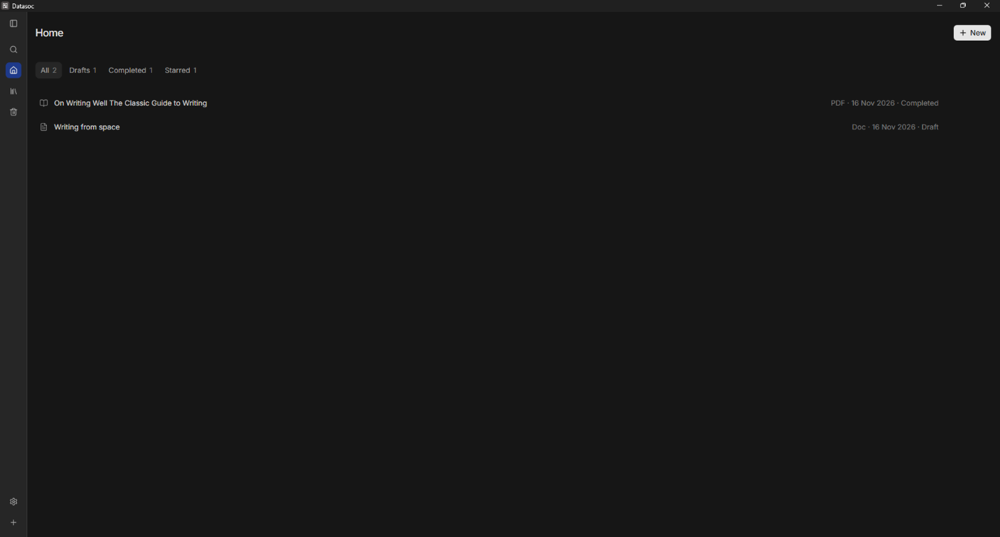

# Datasoc

Datasoc is a desktop knowledge workspace for capturing notes, documents, PDFs, and unfinished ideas in one place.

Your library should not feel like a folder of disconnected files. Datasoc gives each record a place, status, tags, and searchable content, so past knowledge remains easy to find.



## Why Datasoc?

Information is easy to save and surprisingly difficult to retrieve.

Datasoc is designed around the idea that you should be able to return to something you wrote before without remembering exactly where you put it or the exact words you used.

Use it to keep:

- Draft documents and completed notes
- PDF reference material
- Research notes
- Logs and personal records
- Articles you want to revisit
- Documents, ideas, and unfinished writing

Datasoc combines familiar file-management ideas with a fast, organized writing workspace.

## What You Can Do

- **Write and edit rich-text records**
  Create notes with headings, lists, links, highlights, images, tables, and formatting.

- **Import PDF documents**
  Add PDFs to the library and extract their text for searching.

- **Keep everything organized**
  Use drafts, completed records, starred records, tags, favorites, and trash.

- **Find records by meaning or words**
  Search with normal keywords or describe what you remember in natural language.

- **Browse the library**
  Move between the home screen, full library, search, settings, and trash.

- **Work comfortably**
  Use a compact interface, light or dark themes, keyboard navigation, and global search.

- **Move your data**
  Export records as JSON or import a previous Datasoc export.

- **Back up to the cloud**
  Optionally store database snapshots in the configured S3-compatible storage provider.

- **Keep the main library local**
  Records, PDFs, database indexes, and semantic embeddings stay on your device.

## Main Interfaces

### Home

See drafts, completed records, starred records, and all active records at a glance.

### Library

Browse the complete collection of records.

### Search

Search by title or content and reuse recent searches.

### Editor

Write and format documents with a rich-text editor.

### PDF Viewer

Open imported PDFs in an integrated viewer. PDF records are currently read-only within the editor.

### Trash

Deleted records remain available for later review instead of disappearing immediately.

### Settings

Configure your account, appearance, library preferences, backups, JSON export and import, and keyboard shortcuts.

## Privacy and Data

Datasoc is local-first:

- The desktop database is stored locally.
- Full-text search and semantic search run locally.
- The embedding model is executed on your device.
- Document text is not sent to a hosted embedding API.

Some optional integrations do use external services:

- Account and session support can use a Turso database.
- Cloud database backups use S3-compatible storage.
- PDF text extraction and local editing do not require a cloud service.

A **Turso account** is not required to run the local record database. It is used only by the account/authentication integration and configuration in this repository.

## Requirements

You will need:

- Windows 10 or Windows 11
- [Bun](https://bun.sh/)
- [Rust](https://rustup.rs/)
- CMake
- C++ build tools
- LLVM
- The Datasoc MiniLM embedding model

## Environment Configuration

Create a `.env` file in the project root with placeholders for your own accounts:

```dotenv
AUTH_SECRET="generate-a-long-random-secret"

TURSO_DATABASE_URL="libsql://your-database-name.turso.io"
TURSO_AUTH_TOKEN="your-turso-auth-token"

S3_KEY_ID="your-s3-or-backblaze-key-id"
S3_APP_KEY="your-s3-or-backblaze-application-key"
S3_ENDPOINT="s3.us-east-005.backblazeb2.com"
```

### Variables

| Variable | Used for |
| --- | --- |
| `AUTH_SECRET` | Signing and protecting account sessions |
| `TURSO_DATABASE_URL` | Turso database used by account/authentication support |
| `TURSO_AUTH_TOKEN` | Authentication for the Turso database |
| `S3_KEY_ID` | S3-compatible or Backblaze B2 account key |
| `S3_APP_KEY` | S3-compatible or Backblaze B2 application key |
| `S3_ENDPOINT` | Endpoint used for cloud database backups |

Generate an authentication secret with Node or Bun:

```powershell
node -e "console.log(require('crypto').randomBytes(32).toString('base64url'))"
```

The `.env` file is ignored by Git. Never commit real credentials or share an existing `.env` file publicly.

> **Important:** If you obtained this repository from a source that already contains real-looking credentials, rotate them before building or distributing the app.

## Optional Cloud Services

### Turso authentication

The authentication system uses a Turso database. Without valid Turso credentials, account sign-in and registration will not be available.

You can create a Turso database and generate credentials using the Turso CLI:

```powershell
turso db create
turso db show
turso db tokens create
```

Then enter the resulting database URL and token in `.env`.

The sign-in screen uses email and password credentials. Signing in with a new email creates an account; signing in with an existing email verifies the password.

### Cloud backups

Cloud backups use an S3-compatible provider, currently integrated with Backblaze B2 naming and endpoints.

If the S3 variables are omitted:

- Automatic cloud backups will remain unavailable.
- The rest of the local application may still be usable.
- JSON export and import remain available for moving a portable copy of your library.

A cloud restore replaces the local database. Datasoc asks you to review the difference between the two libraries before continuing.

## MiniLM Setup

Datasoc needs a local MiniLM GGUF model for semantic search.

1. Download the quantized model:
   [all-MiniLM-L6-v2 Q8 model](https://huggingface.co/huoxu/all-MiniLM-L6-v2-Q8_0-GGUF/resolve/main/all-minilm-l6-v2-q8_0.gguf?download=true)
2. Rename the file to `minilm-l6.gguf`.
3. Put it in:

   ```text
   src-tauri/res/minilm-l6.gguf
   ```

The application will not initialize semantic search unless this file is available.

## Windows Build Setup

### 1. Install CMake

```powershell
winget install Kitware.CMake
```

### 2. Install C++ build tools

**Windows 10**

```powershell
winget install Microsoft.VisualStudio.BuildTools --force --override "--wait --passive --add Microsoft.VisualStudio.Component.VC.Tools.x86.x64 --add Microsoft.VisualStudio.Component.Windows10SDK"
```

**Windows 11**

```powershell
winget install Microsoft.VisualStudio.BuildTools --force --override "--wait --passive --add Microsoft.VisualStudio.Component.VC.Tools.x86.x64 --add Microsoft.VisualStudio.Component.Windows11SDK.26100"
```

### 3. Install LLVM

Download and install LLVM for Windows:

- [LLVM releases](https://github.com/llvm/llvm-project/releases)

### 4. Install Rust and Bun

Make sure both tools are available in the same terminal used to build Datasoc.

```powershell
rustc --version
bun --version
cmake --version
clang --version
```

Restart the terminal after installation if any command is not found.

## Run from Source

Install dependencies:

```powershell
bun install
```

Start the desktop application:

```powershell
bunx tauri dev
```

Datasoc is currently distributed and tested as a Windows desktop application. A web-only build may not provide all local database and native PDF features.

## Build a Windows Installer

```powershell
bunx tauri build
```

The NSIS installer is produced from the configuration in `src-tauri/tauri.conf.json`.

## Development Commands

| Command | Purpose |
| --- | --- |
| `bun dev` | Start the frontend development server |
| `bun run build` | Build the frontend |
| `bun run preview` | Preview the built frontend |
| `bunx tauri dev` | Start the desktop application |
| `bunx tauri build` | Build the Windows installer |
| `bun run db:generate` | Generate Drizzle migrations |
| `bun run db:migrate` | Apply database migrations |
| `bun run db:studio` | Open Drizzle Studio |
| `bun run check` | Run the Biome checker |
| `bun run lint` | Run the linter |
| `bun run format` | Format source files |

## Keyboard Shortcuts

| Shortcut | Action |
| --- | --- |
| `Ctrl+K` / `Cmd+K` | Open search |
| `Ctrl+B` / `Cmd+B` | Toggle the sidebar |
| `J` / `K` | Navigate PDF pages |
| `Home` / `End` | Go to the first or last PDF page |

## Project Status

Datasoc is currently in beta.

Features and storage formats may continue to change while the local workspace and backup systems mature.
